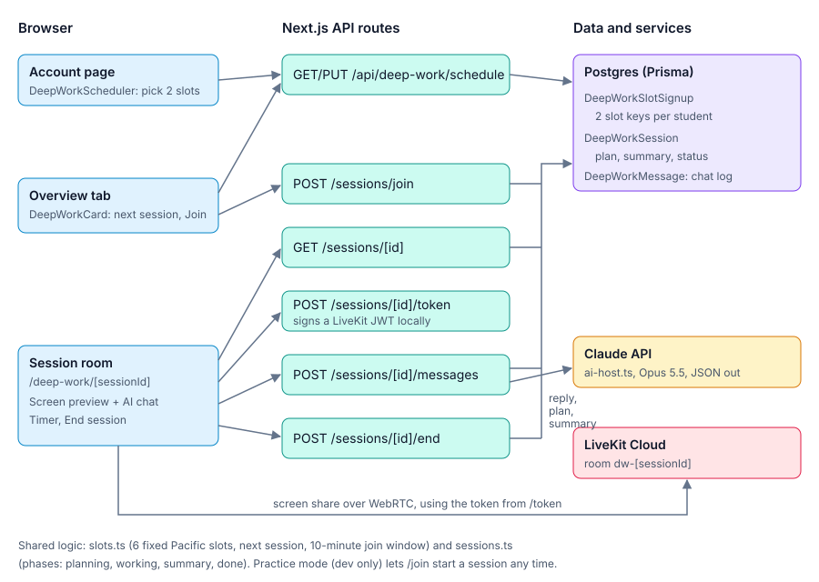
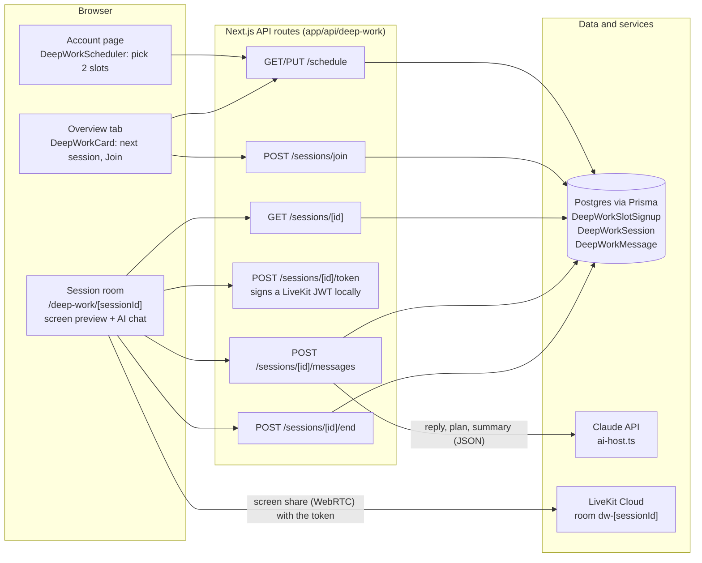

# Deep Work architecture

The parts added so far: weekly slot signup (step 1), and the session room with its AI host and screen share (step 2). Screen checks (step 3) and the Slack bot (step 4) come later.

## Diagram (Mermaid)

## How the pieces fit

- **Slots.** The 6 fixed Pacific-time slots live in code (`app/lib/deep-work/slots.ts`), not the database. Each student's 2 picks are rows in `DeepWorkSlotSignup`, saved through `/schedule`.
- **Joining.** From 10 minutes before a slot starts until it ends, the Overview card shows **Join session**. `/sessions/join` creates this week's `DeepWorkSession` row, keyed on `userId` and `scheduledStart`, together with the host's opening message, or reopens the row if it already exists.
- **AI host.** Each student message makes one server-side Claude call (`app/lib/deep-work/ai-host.ts`), and Claude answers in structured JSON. The server saves the reply to `DeepWorkMessage`, and saves the plan or summary to `DeepWorkSession`. Session phases (`app/lib/deep-work/sessions.ts`) go planning, working, summary, done. `/end` (the End button, or the timer running out) moves a session to summary.
- **Screen share.** `/token` signs a LiveKit token on the server (`app/lib/deep-work/livekit.ts`) that can publish only a screen share. The browser then publishes straight to LiveKit Cloud, so video never passes through our server, and nothing is recorded.
- **Practice mode.** With `DEEP_WORK_PRACTICE_MODE=true`, outside production only, `/join` can start a session at any time for local testing.
