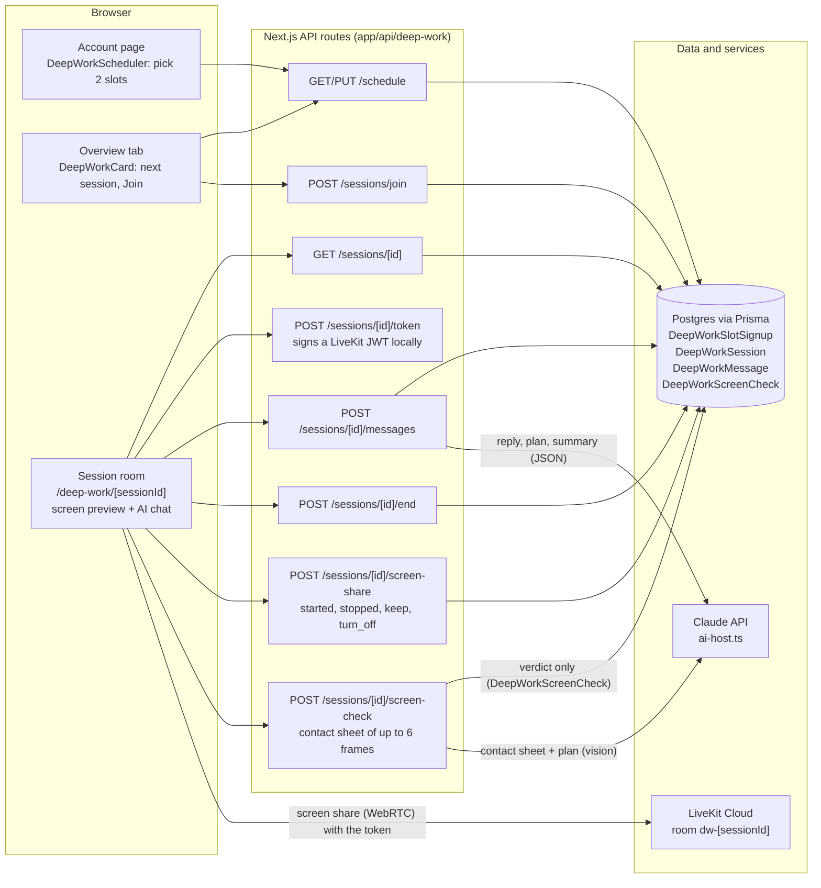

# Deep Work architecture

The parts added so far: weekly slot signup (step 1), the session room with its AI host and screen share (step 2), and the 30-minute screen checks (step 3). The Slack bot (step 4) comes later. The image below doesn't show the screen check routes yet; the Mermaid diagram does.

## Diagram (Mermaid)

## Key workflows

Each walkthrough follows the diagram from left to right. **Browser** boxes are blue, **API route** boxes are teal, and **Data and services** boxes are purple (Postgres), amber (Claude) and pink (LiveKit).

### 1. Picking weekly slots

*Diagram: Account page → `GET/PUT /schedule` → Postgres (`DeepWorkSlotSignup`)*

1. The student opens **Account page** (`/account#deep-work`). `DeepWorkScheduler` (`components/deep-work-scheduler.tsx`) calls `GET /api/deep-work/schedule` to load their current picks.
2. The route (`app/api/deep-work/schedule/route.ts`) reads the student's `DeepWorkSlotSignup` rows from Postgres. It returns them in weekly order, along with the next upcoming session. That calculation, `nextDeepWorkSession` in `app/lib/deep-work/slots.ts`, handles daylight saving.
3. The student picks exactly 2 of the 6 fixed slots and clicks Save, which sends `PUT /schedule` with `{ slotKeys: ["mon-19", "thu-18"] }`.
4. The route checks the pick (`validateSlotSelection`: exactly 2 distinct slots that exist). In one transaction it deletes the old rows and inserts the new ones. Picks repeat every week until the student changes them.

The slot list itself lives in code, not in Postgres, so adding or moving a slot is a one-line edit to `DEEP_WORK_SLOTS`.

### 2. Seeing the next session and joining

*Diagram: Overview tab → `GET/PUT /schedule`; Overview tab → `POST /sessions/join` → Postgres (`DeepWorkSession`, `DeepWorkMessage`)*

1. **Overview tab** renders `DeepWorkCard` (`components/deep-work-card.tsx`), which calls `GET /schedule`, the same route as workflow 1. It shows the student's slots and next session, or the amber "pick your sessions" prompt if they have none.
2. Every 30 seconds the card checks `canJoinNow`: whether the time is between `joinOpensIso` (10 minutes before the start) and the session's end. Once it is, the button changes from "Change sessions" to **Join session**.
3. Clicking Join sends `POST /api/deep-work/sessions/join`. The route (`app/api/deep-work/sessions/join/route.ts`) recomputes the open session from the student's slots, so the server never trusts the browser's clock. Outside a window it answers 409.
4. It looks up the `DeepWorkSession` row for this student and this occurrence, which is unique on `userId` and `scheduledStart`:
   - **No row yet:** it creates one with status `ACTIVE`, a LiveKit room name `dw-<sessionId>`, and the host's opening `DeepWorkMessage`.
   - **A row exists** (a refresh or a second tab): it reuses it, so a student has one session per slot per week.
5. The route returns `{ sessionId }`, and the browser navigates to **Session room** (`/deep-work/<sessionId>`).

With `DEEP_WORK_PRACTICE_MODE=true` (outside production only), the card also offers "Start practice session". It sends `POST /join` with `{ practice: true }`, which creates a 2-hour session starting now.

### 3. Planning, working and chatting with the AI host

*Diagram: Session room → `GET /sessions/[id]`, `POST /sessions/[id]/messages` → Claude API, and → Postgres*

1. **Session room** (`components/deep-work-room.tsx`) loads the session and its chat through `GET /api/deep-work/sessions/[id]`. Every session route first checks that the session belongs to the signed-in student (`findOwnSession` in `app/lib/deep-work/session-store.ts`), and refuses the instructor `?userId=` parameter.
2. The student types a message, which sends `POST /sessions/[id]/messages`. The route (`app/api/deep-work/sessions/[id]/messages/route.ts`) saves the message as a `STUDENT` row, then reads the whole chat back from Postgres.
3. It works out the session's **phase** from the row (`sessionPhase` in `app/lib/deep-work/sessions.ts`):
   - **planning:** `ACTIVE` with no plan yet;
   - **working:** `ACTIVE` with a plan;
   - **summary:** `WRAPPING_UP`;
   - **done:** `COMPLETED`.
4. It makes **one Claude API call** (`runHostTurn` in `app/lib/deep-work/ai-host.ts`). The request has a fixed system prompt, the full chat, and a system note at the end with the phase rules, the student's name, the time left and the saved plan. Claude must answer in JSON: `{ reply, plan, summary }`.
   - **planning:** if the student gave a concrete plan, Claude returns it in `plan`. If not, Claude asks one clarifying question.
   - **working:** Claude answers briefly and fills `plan` only if the student changes it.
5. The route saves the reply as an `AI` message, saves the plan to `DeepWorkSession.plan` if one was captured, and returns the updated session and chat. The page pins the plan at the top of the chat.

If the Claude call fails, the student's message stays saved, and the route answers 502 so the page can show an error. If Claude declines a message, the server-side fallback retries it on another model. Anything still unusable gets a safe fallback reply.

No AI process sits in the LiveKit room. The host is stateless: each turn is rebuilt from the database.

### 4. Sharing the screen

*Diagram: Session room → `POST /sessions/[id]/token`; Session room → LiveKit Cloud (the arrow along the bottom)*

1. The student clicks **Share screen**, which sends `POST /sessions/[id]/token`.
2. The route (`app/api/deep-work/sessions/[id]/token/route.ts`) checks that the session is the student's and hasn't ended. It then signs a LiveKit access token on our server (`createRoomToken` in `app/lib/deep-work/livekit.ts`), using `LIVEKIT_API_KEY` and `LIVEKIT_API_SECRET`. This makes no network call to LiveKit. The token:
   - lets the student into room `dw-<sessionId>` only;
   - lets them publish **only a screen share** (no camera or mic);
   - expires 30 minutes after the session's scheduled end.
3. The browser uses `livekit-client` to connect to **LiveKit Cloud** with that token, and publishes the screen over WebRTC. The video goes straight from the browser to LiveKit, never through our server, and nothing is recorded. The page shows a local preview.
4. If the student cancels the picker or uses the browser's own "Stop sharing" bar, the page leaves the room. Without the `LIVEKIT_*` env vars the token route answers 503 and the room runs chat-only.

Workflow 6 explains how screen checks use frames from this track.

### 5. Ending a session and capturing the summary

*Diagram: Session room → `POST /sessions/[id]/end` → Postgres; then Session room → `POST /sessions/[id]/messages` → Claude API → Postgres*

1. A session starts to end in one of two ways:
   - the student clicks **End session**;
   - the page's timer reaches the scheduled end and calls the same route on its own.

   Either way the page sends `POST /sessions/[id]/end`, and when the session switches to wrap-up the page plays the same chime as an off-track screen check (`playAlertChime`). Any click on the page unlocks sound beforehand.
2. The route (`app/api/deep-work/sessions/[id]/end/route.ts`) switches the session from `ACTIVE` to `WRAPPING_UP` and sets `wrapUpAt`. It uses a conditional update, so if two tabs press End only one of them posts the host's wrap-up question. That question (`wrapUpMessage`) quotes the saved plan and asks what got done.
3. The student answers in the chat, which goes through `POST /messages` exactly as in workflow 3, now in the **summary** phase. When Claude returns a `summary`, the route saves it and marks the session `COMPLETED` with `endedAt`.
4. The page shows the summary under the plan, disconnects any screen share, and closes the chat with a "Back to dashboard" link. Later messages to the session get a 409.

A session nobody wraps up stays `WRAPPING_UP`. Step 4 (the Slack bot) will nudge students who haven't sent a summary.

### 6. Screen checks every 30 minutes

*Diagram (Mermaid): Session room → `POST /sessions/[id]/screen-share` → Postgres; Session room → `POST /sessions/[id]/screen-check` → Claude API, and the verdict → Postgres*

1. When the screen share starts, the room page sends `POST /screen-share` with `{ action: "started" }`. The route (`app/api/deep-work/sessions/[id]/screen-share/route.ts`) sets `screenShareOn` and schedules `nextScreenCheckAt` 30 minutes out:
   - **A check is already scheduled** (for example after a page refresh): it keeps that time, so a refresh can't skip a check.
   - **That check is overdue:** it moves it one frame interval out, so the browser can collect frames first.
2. While sharing, the page (`components/deep-work-room.tsx`) keeps one small frame every 5 minutes from its own screen-share track (`captureFrame` in `components/deep-work-screen-frames.ts`). It uses `ImageCapture`, which keeps working while the tab is in the background, and falls back to the preview video in other browsers. It keeps at most 6 frames, **in memory only**.
3. Once `nextScreenCheckAt` has passed, the page tiles the frames into one labelled contact sheet (`buildContactSheet`, a 3x2 grid of 640x360 frames, about 300 KB as JPEG). It sends the sheet with the frame times to `POST /screen-check`, then drops the frames.
4. The route (`app/api/deep-work/sessions/[id]/screen-check/route.ts`) checks that the session is `ACTIVE`, sharing is on, and the check is due. It then **claims** the check by moving `nextScreenCheckAt` 30 minutes ahead in a conditional update, so two tabs can't both run it. Without a saved plan it stops here, because there is nothing to compare against.
5. One Claude vision call (`runScreenCheck` in `app/lib/deep-work/screen-checks.ts`) sees the contact sheet and the plan. It judges **relevance and progress over time**: the same file unchanged across the frames counts as stalled, even if it's relevant. It answers `{ on_track, note, message }`.
6. The route stores **only** a `DeepWorkScreenCheck` row (`checkedAt`, `onTrack`, a one-line `note`, `frameCount`). The image is never written to the database or logs. On the first check, the 30-minute mark, it also saves the verdict on the session as `firstCheckOnTrack`. It then posts the AI's chat message and sets `pendingShareChoice`, so the page shows two buttons: keep sharing for another 30 minutes, or turn screen sharing off.
   - **On track:** the message says what looks good and asks whether to keep tracking or turn sharing off.
   - **Drifted:** the message tells them they seem to have drifted from their plan, and the page plays the alert chime. It offers to keep sharing for another 30 minutes to help them refocus, which is optional.
7. Checks stop when the session wraps up. `/end` also clears any pending choice.

**Required sharing.** With LiveKit set up, screen sharing is required for the first 30 minutes: while a session is `ACTIVE` and its first screen check hasn't happened (`firstCheckOnTrack` is null; `screenShareRequired` in `app/lib/deep-work/sessions.ts`). After that check, on track or not, sharing is the student's choice.
- **Chat lock:** while sharing is required and they aren't sharing, the room page replaces the chat box with a "Share your screen" panel, and `POST /messages` answers 403.
- **Stopping early:** stopping before the first check locks the chat again until they reshare. The check schedule is kept.
- **Always allowed:** End session and the summary step never need sharing.
- **Closing the page:** the page sends a `stopped` beacon so the server knows sharing ended.
- **Reminder chime:** if they still haven't shared 5 minutes after joining, the page plays the chime once (`shareReminderDelayMs`).

For local testing, `DEEP_WORK_SCREEN_CHECK_MINUTES=3` (ignored in production) shortens the interval, and frames come every interval ÷ 6.
